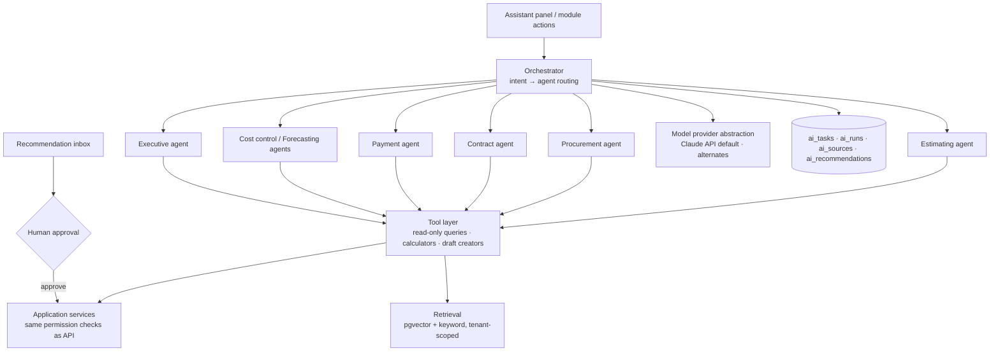

# AI Architecture — the AI Commercial Director

**Status: design only. No AI functionality is implemented in Phase 1.** Implementation is Phase 4. This
document fixes the architectural constraints now so that Phase 2–3 data models support it (sources,
traceability, approval states).

## 1. Principles (non-negotiable)

1. **AI drafts and recommends; authorised humans approve.** Agents never write to financial tables.
2. **AI respects permissions.** Every retrieval and tool call executes as the requesting user, inside their
   tenant RLS context and permission set. There is no privileged "AI service account" that can see more.
3. **Cite or abstain.** Every factual statement links to a source record or document chunk; otherwise the
   assistant says it does not know.
4. **Facts ≠ assumptions.** Outputs separate extracted facts, calculated values (from deterministic services),
   assumptions and suggestions.
5. **Numbers come from code.** Models may choose *which* calculation to run (tool call); the calculation itself
   is executed by the same tested services the UI uses.
6. **Labelled.** AI-generated content is visually and structurally distinct (`ai_generated = true`, model,
   prompt version, run id) and never silently becomes a verified record.

## 2. Components

* **Provider abstraction:** a `ModelProvider` interface (`generate`, `generate_structured`, `embed`) with a
  Claude implementation as default and room for alternates; model IDs, temperature and prompt versions are
  configuration, recorded on every run.
* **Structured outputs:** agents return JSON validated by Pydantic schemas (e.g. `BidLevelingResult`,
  `ContractObligation`, `PayAppReviewFinding`). Invalid output is rejected and retried, never coerced.
* **Tools:** small, typed, permission-checked functions, e.g. `search_documents`, `get_project_financials`,
  `list_change_orders`, `calculate_forecast`, `draft_change_order`. "Draft" tools create records in a
  `draft`/`ai_proposed` state that a human must approve.
* **Retrieval:** document ingestion (text extraction, OCR for scanned drawings) → chunks with page/sheet
  references → embeddings in pgvector, filtered by `tenant_id` *and* project visibility before ranking.

## 3. Data model (Phase 4 migration)

| Table | Purpose |
|---|---|
| `ai_tasks` | A user request or scheduled review (who, what, scope, status) |
| `ai_runs` | Each model invocation: provider, model, prompt version, token usage, latency, input/output hashes |
| `ai_sources` | Records/chunks retrieved and cited, with document version + page |
| `ai_recommendations` | Suggested action, rationale, confidence, facts vs assumptions, linked sources, approval status, approver, decision time |
| `document_chunks` | Text, page/sheet ref, embedding `vector(…)`, tenant/project/document version |

## 4. Safety

* **Prompt injection:** retrieved content is passed as quoted data with provenance, never as instructions;
  tools enforce authorisation independently of the model; high-impact tools are draft-only; output is
  checked for references to records outside the retrieved set.
* **Data isolation:** retrieval queries run under RLS; cross-tenant embeddings never share an index scope;
  no customer data is used to train models (contractual setting with providers).
* **Confidence:** reported as evidence coverage (fraction of claims with citations) plus model self-assessment,
  never as a bare percentage without explanation.

## 5. Evaluation framework

* Golden datasets per agent (e.g. 50 anonymised subcontractor quotes with expected normalised scope and
  exclusions; contracts with known notice periods).
* Automated metrics: factual accuracy vs gold, citation precision/recall, refusal correctness, permission-leak
  tests (a user without access must not receive content from restricted projects), prompt-injection suites.
* Regression gate in CI for prompt or model changes; results stored per prompt version.
