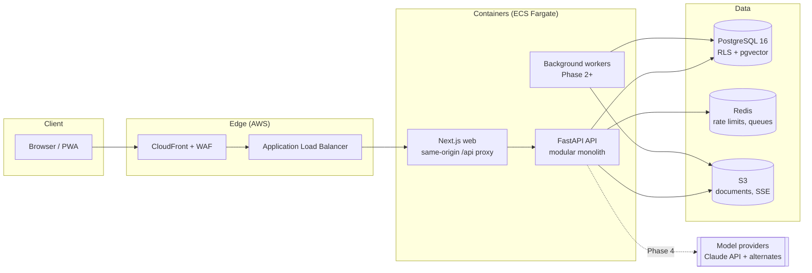

# Technical Architecture

_Last updated: Phase 1 (Foundation)._

## 1. Overview

QS Intelligence USA is a **modular monolith**: one deployable API (FastAPI) and one web application (Next.js),
backed by PostgreSQL, Redis and S3-compatible object storage. Domains are separated in code with explicit
service boundaries so that any domain can later be extracted if scale demands it — but we do not pay the
operational cost of microservices before we need to (ADR-001).



## 2. Technology choices (pinned)

| Layer | Choice | Version |
|---|---|---|
| API | FastAPI, Pydantic v2, SQLAlchemy 2.1 (sync), Alembic, psycopg 3 | 0.163.2 / 2.14.3 / 2.1.9 / 1.20.1 / 3.3.9 |
| Security libs | argon2-cffi, PyJWT, pyotp, cryptography (Fernet) | 25.1.0 / 2.15.1 / 2.12.0 / 50.0.2 |
| Database | PostgreSQL 16 + pgvector + pg_trgm | 16.x / 0.8 |
| Cache / coordination | Redis | 7.x |
| Web | Next.js, React, TypeScript, Tailwind CSS, TanStack Query, react-hook-form, zod, Radix UI | 15.5.29 / 19.3.1 / 5.9.3 / 4.3.5 / 5.108 / 7.92 / 4.6 / 1.x |
| Tests | pytest, Vitest, Testing Library, Playwright | 9.2 / 3.2.7 / 16.3 / 1.63.0 |

Exact pins live in `backend/pyproject.toml` and `frontend/package.json` (+ `package-lock.json`).
Upgrade policy: ADR-012.

## 3. Backend structure

```
app/
  core/         config · db (engine, RLS context) · security · money · errors · ratelimit · schemas
  api/deps.py   authentication → tenant resolution → permission checks (the request pipeline)
  domains/
    identity/   users, sessions, MFA, registration, invitations (acceptance)
    tenancy/    tenants, memberships, roles, permissions, invitations (issuing)
    projects/   projects, team, parties, phases, vocabularies
    companies/  directory: companies, contacts, addresses
    documents/  documents, immutable versions, object storage
    audit/      append-only audit events
    dashboard/  portfolio aggregates
```

Each domain has `models.py` (ORM), `schemas.py` (API contracts), `service.py` (business rules, no HTTP) and
`router.py` (HTTP only). Routers never contain business rules; services never commit (ADR-004).

Planned domains (empty until their phase, never stubbed): estimating, measurement, cost_database,
procurement, bids, contracts, subcontracts, commitments, payment_applications, change_orders,
cost_management, forecasting, field_operations, compliance, analytics, ai_orchestration, integrations,
notifications, reporting.

## 4. Request lifecycle and tenant isolation

```mermaid
sequenceDiagram
  participant C as Client
  participant D as deps.py
  participant DB as PostgreSQL
  C->>D: request + cookie/Bearer + X-Tenant-ID
  D->>D: verify JWT (typ=access); CSRF check if cookie auth
  D->>DB: set_config('app.user_id', …, local)
  D->>DB: SELECT membership (RLS: own memberships visible)
  D->>DB: set_config('app.tenant_id', …, local)
  D->>D: load role permissions → TenantContext
  D->>D: require(permission) per route
  Note over DB: Every tenant table: USING (tenant_id = app_current_tenant())
  C-->>D: response (single commit at end of unit of work)
```

* The runtime DB role `qs_app` is **not** the table owner and has `NOBYPASSRLS`, so RLS always applies.
* The RLS context is stored on the SQLAlchemy session and re-applied by an `after_begin` hook to every new
  transaction, so data loaded after a commit stays correctly scoped (ADR-003).
* Without context, policies evaluate to no rows (fail-closed).
* Composite foreign keys `(tenant_id, x_id) → parent(tenant_id, id)` make cross-tenant references
  impossible even though FK checks bypass RLS.

## 5. Frontend structure

* **Same-origin API**: the browser calls `/api/v1/*`, which Next.js rewrites to the API. Auth cookies are
  first-party, `HttpOnly`, `SameSite=Lax`; mutations carry a double-submit CSRF header.
* **Data**: TanStack Query; the API client performs single-flight refresh on 401.
* **Forms**: react-hook-form + zod for instant validation; the server re-validates everything.
* **Money**: received as decimal strings; formatted with string/BigInt arithmetic (`lib/money.ts`). The UI
  performs no financial calculations.
* **Design system**: semantic CSS tokens (`globals.css`) with navy dark and white light themes; primitives
  in `components/ui`. Unbuilt modules appear in navigation as non-interactive "Phase N" items.
* **PWA**: web manifest and icons in Phase 1; offline capture (service worker + IndexedDB queue) arrives
  with Field Operations (Phase 5).

## 6. Deployment architecture (target)

* **Environments**: `development` (local), `staging`, `production` — separate AWS accounts, separate
  databases, separate secrets. The API refuses to start outside development with insecure secrets.
* **Compute**: ECS Fargate services for `web`, `api`, `worker`; images from the Dockerfiles in this repo.
* **Data**: RDS PostgreSQL 16 (Multi-AZ, encrypted, PITR), ElastiCache Redis, S3 with SSE-KMS and versioning.
* **Edge**: CloudFront + AWS WAF managed rules + rate-based rules; ALB with TLS 1.2+.
* **Secrets**: AWS Secrets Manager, injected as environment variables at task start.
* **IaC**: Terraform (planned, Phase 6 hardening; tracked in the backlog). Nothing is deployed yet and no
  deployment will happen without explicit authorisation.

## 7. Background work

Phase 1 has no asynchronous jobs. Phase 2 introduces a worker (Redis-backed queue) for document processing,
malware scanning, report generation and integration sync. Jobs will run with an explicit tenant context and
the same RLS role.

## 8. Internationalisation readiness

Currency is stored per amount; addresses carry `country_code`; measurement system and time zone are tenant
settings; vocabularies are served by the API. US English and USD are the only enabled locale today.
